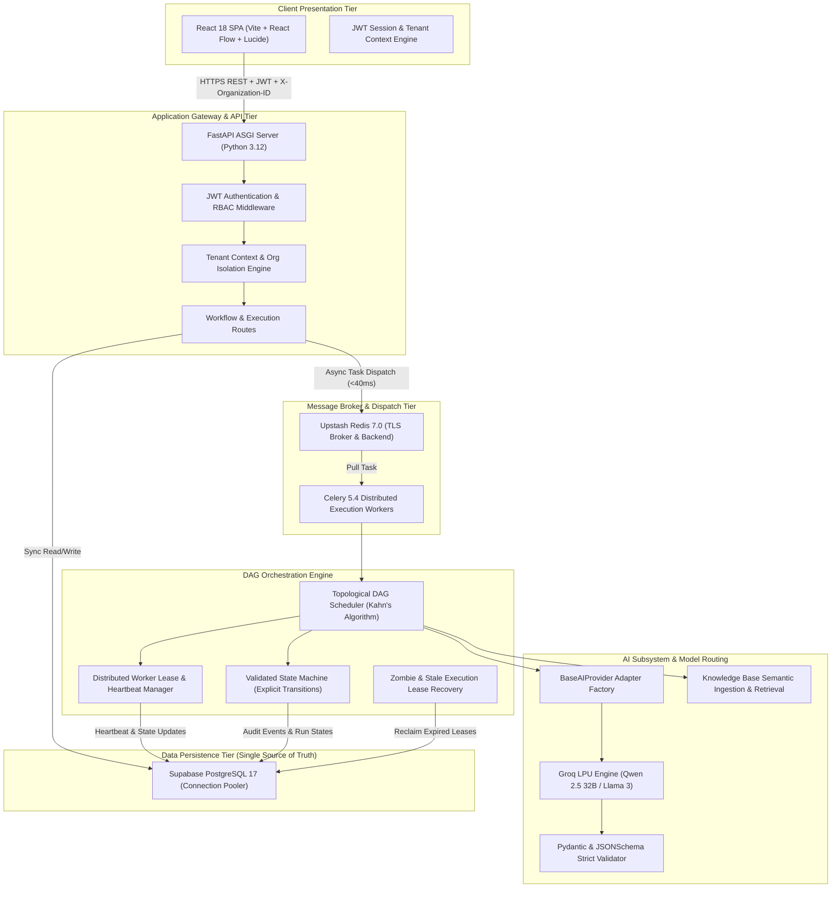
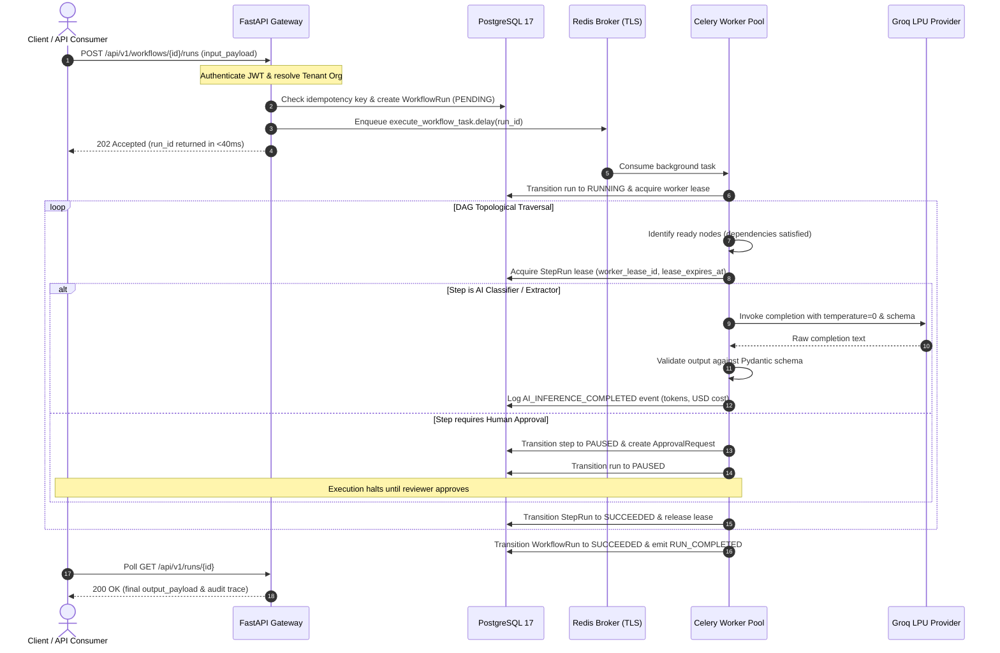
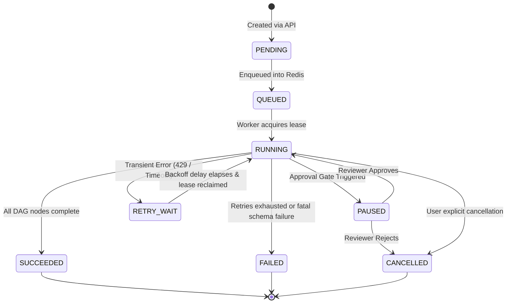
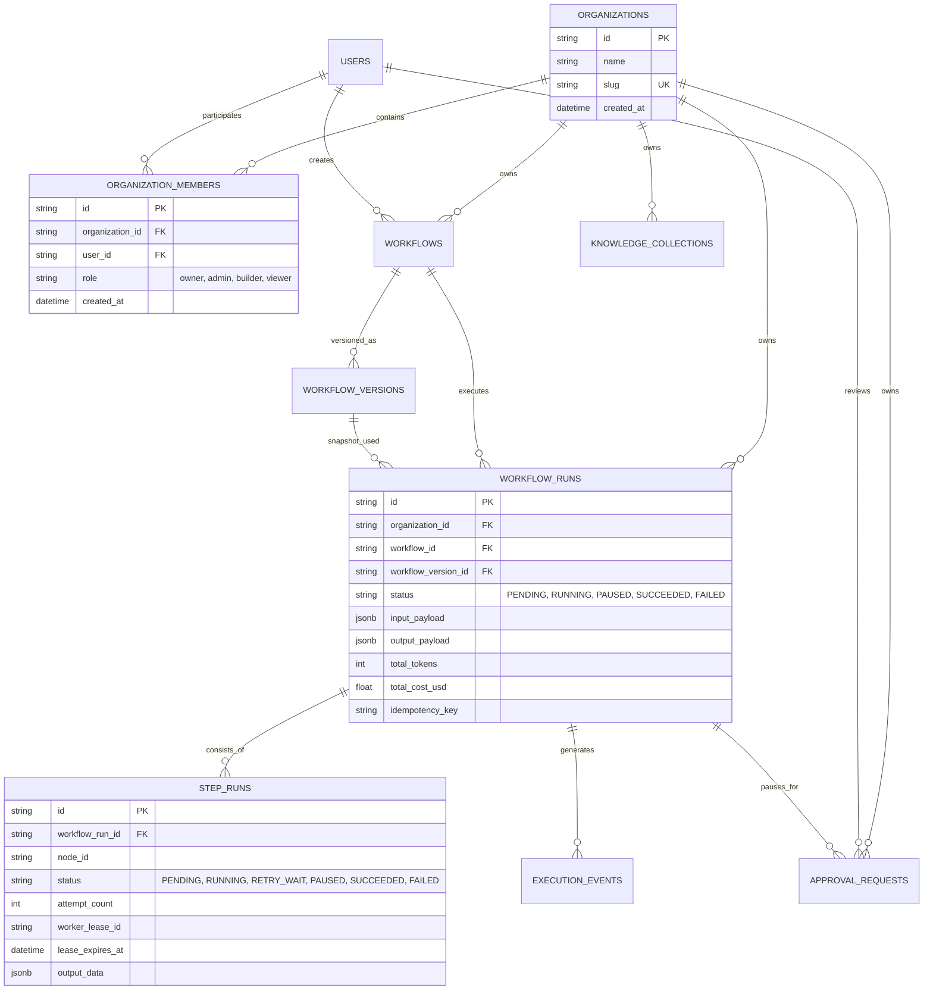

# FlowForge AI

> **"Design, execute, monitor, and evaluate reliable AI-powered workflows."**

FlowForge AI is an enterprise-grade visual workflow orchestration platform that designs, executes, monitors, and benchmarks AI workflows with durable state persistence, distributed worker concurrency, multi-tenant organization isolation, human-in-the-loop review gates, semantic knowledge retrieval, and automated evaluation suites.

---

## 🌟 Table of Contents
1. [Product Overview & Business Value](#-product-overview--business-value)
2. [High-Level System Architecture](#-high-level-system-architecture)
3. [Execution Lifecycle Sequence](#-execution-lifecycle-sequence)
4. [DAG Orchestration Engine Internals](#-dag-orchestration-engine-internals)
5. [AI Subsystem & Deterministic Guardrails](#-ai-subsystem--deterministic-guardrails)
6. [Multi-Tenant SaaS Architecture & Security](#-multi-tenant-saas-architecture--security)
7. [Database Schema & Tenancy Model](#-database-schema--tenancy-model)
8. [REST API v1 Specification Catalog](#-rest-api-v1-specification-catalog)
9. [Enterprise Guided Blueprints & Use Cases](#-enterprise-guided-blueprints--use-cases)
10. [Staff Engineer System Design Interview Q&A](#-staff-engineer-system-design-interview-qa)
11. [Quick Start & Local Execution](#-quick-start--local-execution)
12. [Testing & Verification](#-testing--verification)

---

## 💡 Product Overview & Business Value

### What is FlowForge AI?
FlowForge AI bridges the gap between non-deterministic Large Language Models (LLMs) and mission-critical software engineering. While simple chatbots and naive RAG scripts struggle with hallucinated outputs, network timeouts, and uncontrolled financial liability, FlowForge wraps AI inference in deterministic software guardrails:
- **Durable Execution**: DAG state persists in PostgreSQL; if a server crashes, workers recover in-flight step leases without data loss.
- **Topological DAG Scheduling**: Parallel step execution, cycle detection, and conditional branching.
- **Human Governance**: High-risk steps (e.g. issuing a refund > $50) pause cleanly and await authorized reviewer approval in an inbox queue.
- **Continuous Benchmarking**: Automated evaluation suites track classification accuracy, latency percentiles, and token costs across releases.

---

## 🏛️ High-Level System Architecture

FlowForge AI is architected with strict separation of concerns across presentation, API gateway, message broker, distributed execution worker pool, and persistent relational storage.



---

## 🔄 Execution Lifecycle Sequence

The sequence below illustrates an end-to-end workflow execution run from initial API ingestion, through Redis queue dispatch, topological worker step execution, AI completion with schema validation, and human approval pausing.



---

## ⚙️ DAG Orchestration Engine Internals

FlowForge's execution engine operates as an explicit, validated finite state machine. Every state transition is recorded as an immutable audit event in PostgreSQL.



### Key Concurrency & Reliability Safeguards:
1. **Topological Scheduler**: Uses Kahn's algorithm with pre-validation to detect cyclic dependencies before graph execution begins.
2. **Distributed Worker Leases & Heartbeats**: Each step acquisition writes a `worker_lease_id` and `lease_expires_at` timestamp. Prevents duplicate concurrent workers from executing the same node.
3. **Zombie Worker Recovery**: If a worker node crashes or runs out of memory, expired leases are automatically identified and re-enqueued for retry.
4. **Bounded Exponential Backoff with Jitter**:
   $$\text{Delay} = \min\left(\text{MaxBackoff}, \text{Base} \times \text{Factor}^{\text{Attempt}} + \text{Jitter}\right)$$
   Prevents thundering herds from overwhelming free-tier AI API rate limits (HTTP 429).
5. **Immutable Workflow Versions**: Publishing produces an immutable version snapshot with a cryptographic SHA-256 checksum. In-flight runs execute strictly against their snapshot version, preventing mid-run contract drift.

---

## 🧠 AI Subsystem & Deterministic Guardrails

LLMs are inherently non-deterministic. FlowForge AI wraps LLM inference in software engineering guardrails:

- **Universal Provider Abstraction**: Implementations of `BaseAIProvider` isolate provider-specific SDK quirks. FlowForge supports **Groq LPUs** (`qwen/qwen3.8-27b`), **OpenAI** (`gpt-4o`), and local **Ollama** instances.
- **Deterministic Mock Fallback**: For CI test runners and local development without cloud spend, `MockAIProvider` generates deterministic JSON completions matching prompt schema.
- **Structured Schema Enforcement**: Outputs must parse into valid JSON and strictly satisfy Pydantic models. Malformed markdown code fences are automatically stripped and repaired.
- **Semantic Vector Grounding**: Relevant policies and documentation snippets are retrieved from tenant knowledge collections via cosine similarity and injected into prompt context.
- **Token & Cost Telemetry**: Computes prompt tokens, completion tokens, latency, and real-time USD expenditure per step down to 6 decimal places.

---

## 🔐 Multi-Tenant SaaS Architecture & Security

FlowForge AI enforces tenant isolation across API, compute, and storage tiers:
- **Tenant Context Resolution**: Every incoming HTTP request resolves the active tenant organization using the `X-Organization-ID` header combined with the user's JWT bearer token.
- **Server-Side Authorization**: API routes verify that the authenticated user holds valid membership within the requested organization before querying database records.
- **Role-Based Access Control (RBAC)**:
  - `Owner`: Full governance, billing, member management, and workspace deletion.
  - `Admin`: Team invitations, AI provider credentials, and approval decisions.
  - `Builder`: Workflow design, testing, publishing, and execution runs.
  - `Viewer`: Read-only observability for traces, metrics, and audit history.

---

## 🗄️ Database Schema & Tenancy Model

All state is persisted in PostgreSQL (with connection pooling via Supabase).



---

## 📡 REST API v1 Specification Catalog

All private endpoints require `Authorization: Bearer <JWT>` and `X-Organization-ID: <org_id>`:

| Method | Endpoint Path | Tenant Header | RBAC Scope | Description |
| :--- | :--- | :--- | :--- | :--- |
| `POST` | `/api/v1/auth/register` | Optional | Public | Creates user account and provisions default workspace |
| `POST` | `/api/v1/auth/login` | Optional | Public | Authenticates credentials and returns JWT bearer token |
| `GET` | `/api/v1/organizations/` | Optional | Viewer+ | Lists all organizations the authenticated user belongs to |
| `POST` | `/api/v1/organizations/` | Optional | User | Creates a new tenant organization workspace |
| `GET` | `/api/v1/workflows/` | Required | Viewer+ | Lists all workflows scoped to active organization |
| `POST` | `/api/v1/workflows/` | Required | Builder+ | Creates a new workflow draft definition |
| `POST` | `/api/v1/workflows/{id}/publish` | Required | Builder+ | Publishes immutable version with SHA-256 checksum |
| `POST` | `/api/v1/workflows/{id}/runs` | Required | Builder+ | Enqueues execution run into Redis broker (<40ms) |
| `GET` | `/api/v1/runs/{id}` | Required | Viewer+ | Fetches live execution status, tokens, and outputs |
| `GET` | `/api/v1/runs/{id}/events` | Required | Viewer+ | Streams granular state transition audit events |
| `GET` | `/api/v1/approvals/pending` | Required | Admin+ | Lists workflows paused for human governance review |
| `POST` | `/api/v1/approvals/{id}/decision` | Required | Admin+ | Submits approval/rejection decision and resumes run |
| `GET` | `/api/v1/evaluations/datasets` | Required | Viewer+ | Lists benchmark datasets for workflow accuracy |
| `POST` | `/api/v1/evaluations/runs` | Required | Builder+ | Executes batch evaluation suite and logs metrics |

---

## 🎯 Enterprise Guided Blueprints & Use Cases

FlowForge AI comes with pre-configured end-to-end enterprise scenarios available in the `/use-cases` section:

1. **Customer Support Triage & Auto-Refund**:
   - Ticket text ingestion & Pydantic email validation.
   - Groq AI zero-shot classification (`Billing`, `Technical`, `Feature Request`).
   - Vector retrieval of official refund policy limits.
   - Conditional branch: auto-approves refunds $\le \$50.00$; routes refunds $> \$50.00$ to the Human Approval Queue.
2. **Accounts Payable Invoice Auditing**:
   - Extract supplier entity, line items, and invoice subtotals.
   - 3-way matching against purchase orders.
   - Deterministic arithmetic check (tax + subtotal == total).
3. **Legal Contract & NDA Compliance**:
   - Multi-party liability limit extraction.
   - Clause conformance analysis against corporate standard playbooks.

---

## 🎓 Staff Engineer System Design Interview Q&A

### Q1: Why use Celery and Redis rather than executing workflows synchronously in FastAPI?
> **Answer**: LLM inference is high-latency, network-bound I/O taking anywhere from 500ms to 5+ seconds. Executing inference synchronously inside the web process ties up ASGI worker connections. Under moderate concurrency, the threadpool quickly starves, causing HTTP 504 timeouts. By decoupling task dispatch via an Upstash Redis broker, FastAPI returns `HTTP 202 Accepted` in under 40ms. Distributed Celery workers scale horizontally and independently based on queue depth.

### Q2: How does FlowForge AI guarantee idempotent execution?
> **Answer**: Clients supply an `Idempotency-Key` header with their run request. FlowForge generates a SHA-256 hash across the idempotency key and input payload. PostgreSQL enforces a unique constraint on `(organization_id, idempotency_key)`. If a duplicate request arrives (e.g. from network retries), the database rejects duplicate row insertion and the API returns the existing run record, preventing redundant LLM inference costs and duplicate side-effects.

### Q3: What happens if a Celery worker dies mid-workflow execution?
> **Answer**: Every executing DAG step writes a `worker_lease_id` and a bounded `lease_expires_at` timestamp to the database. Running workers emit heartbeats while active. If a worker process crashes or the host undergoes an OOM reboot, a background lease-recovery task detects orphaned `RUNNING` steps with expired leases. These zombie steps are transitioned to `RETRY_WAIT` and re-dispatched up to their configured `max_retries` threshold.

### Q4: How is multi-tenancy enforced without data leaks?
> **Answer**: FlowForge enforces tenant isolation at both the middleware layer and the database layer. Every API request resolves an active Organization from JWT claims or the `X-Organization-ID` header, verifying membership and role. Database queries explicitly filter on `organization_id`, and cross-organization operations are rejected with HTTP 403 Forbidden.

### Q5: How do you evaluate and benchmark non-deterministic LLM workflow outputs?
> **Answer**: FlowForge includes an integrated evaluation benchmark suite. Test datasets with ground-truth expected outputs are executed against workflow versions. The evaluation runner compares outputs using semantic similarity and strict schema validation, recording accuracy scores, token consumption, and p95 latency to detect performance regressions prior to production release.

---

## 🏗️ Quick Start & Local Execution

### Prerequisites
- Python 3.12+
- Node.js 18+ and npm
- PostgreSQL 15+ (Local or Cloud Supabase)
- Redis 7.0+ (Local or Cloud Upstash)

### 1. Repository Setup & Environment Configuration

```bash
git clone https://github.com/your-username/flowforge.git
cd flowforge

# Copy environment configuration
cp .env.example .env
```

Configure your credentials in `.env`:
```ini
DATABASE_URL=postgresql+psycopg2://postgres:<password>@aws-0-eu-west-1.pooler.supabase.com:5432/postgres?sslmode=require
REDIS_URL=rediss://default:<password>@capable-haddock-242252.upstash.io:6379/0
CELERY_BROKER_URL=rediss://default:<password>@capable-haddock-242252.upstash.io:6379/0
CELERY_RESULT_BACKEND=rediss://default:<password>@capable-haddock-242252.upstash.io:6379/0
AI_PROVIDER=groq
AI_MODEL=qwen/qwen3.8-27b
AI_API_KEY=gsk_your_groq_api_key_here
```

### 2. Backend Setup & Database Migrations

```bash
# Create and activate virtual environment
python3 -m venv .venv
source .venv/bin/activate

# Install dependencies
pip install -r backend/requirements.txt

# Apply database migrations
cd backend
alembic upgrade head
cd ..
```

### 3. Start Backend Services

**Terminal 1: FastAPI API Gateway**
```bash
cd backend
../.venv/bin/uvicorn app.main:app --host 0.0.0.0 --port 8000 --reload
```

**Terminal 2: Celery Background Worker**
```bash
cd backend
../.venv/bin/celery -A app.workers.celery_app worker --loglevel=info
```

### 4. Start React Frontend

**Terminal 3: Vite Dev Server**
```bash
cd frontend
npm install
npm run dev
```

Open your browser at `http://localhost:5173`.
- Click **"Platform Engineer"** or **"Staff Architect"** quick-demo buttons on the login screen to sign in instantly.
- Explore `/workflows` to visually design, connect, and validate DAG pipelines.
- Explore `/use-cases` to trigger a live customer support triage workflow.
- Explore `/approvals` to review and approve paused execution gates.
- Explore `/evaluations` to run batch benchmark evaluation test suites.
- Explore `/settings` to manage profile, organization team members, and test AI connectivity.

---

## 🧪 Testing & Verification

### Run Backend Test Suite (53 Tests)
```bash
.venv/bin/pytest backend/tests -v
```

### Run Frontend Test Suite
```bash
cd frontend
npm test
```

### Build Production Frontend
```bash
cd frontend
npm run build
```

---

## 📄 License

This project is licensed under the MIT License - see the [LICENSE](LICENSE) file for details.
