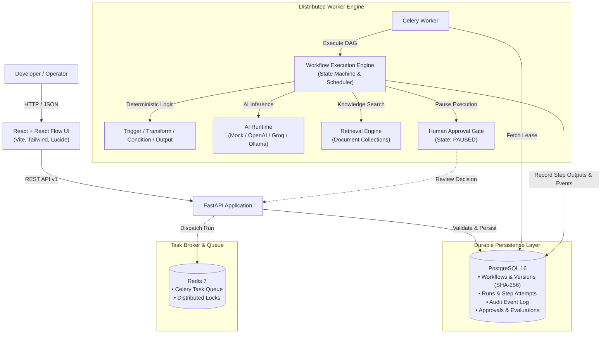

# FlowForge AI

> **"Design, execute, monitor, and evaluate reliable AI-powered workflows."**

FlowForge AI is an enterprise-grade visual workflow orchestration platform that executes, monitors, and benchmarks AI workflows with durable state persistence, bounded retries, human-in-the-loop review gates, semantic knowledge retrieval, and rigorous evaluation suites.

---

## 🌟 Key Features & Architectural Capabilities

### 1. Durable Execution State & Graph Engine
- **PostgreSQL Source of Truth**: Every workflow definition, version, run, step attempt, output payload, and audit event is durably stored in PostgreSQL with full relational integrity.
- **Immutable Workflow Versioning**: Published workflow definitions receive tamper-evident SHA-256 checksums and cannot be mutated. Run records link directly to immutable version snapshots.
- **Deterministic DAG Scheduling**: Dependency-driven topological execution engine (Kahn's algorithm) with cycle detection, orphan node identification, and conditional branch skip cascading.

### 2. Distributed Reliability & Failure Recovery
- **Celery & Redis Asynchronous Execution**: Non-blocking API ingestion returning HTTP 202 Accepted, delegating resilient task processing to distributed workers.
- **Worker Leases & Heartbeats**: Exclusive leases prevent duplicate worker execution; expired leases are automatically re-queued without re-executing successful steps.
- **Exponential Backoff with Full Jitter**: Intelligently retries transient network and rate-limit errors while immediately failing permanent validation errors.
- **Idempotency Keys**: Run requests support `Idempotency-Key` headers to guarantee exactly-once execution.

### 3. Modular AI Runtime & Structured Validation
- **Zero API Key Requirement**: Ships with a high-fidelity deterministic `MockAIProvider` with keyword heuristics, realistic latency/token simulation, and JSON schema mock generation. Runs completely offline in CI and local dev.
- **Universal Provider Adapter**: Seamlessly integrates with OpenAI (`gpt-4o`, `gpt-4o-mini`), Groq (`llama-3.3-70b-versatile`), and local Ollama instances.
- **Strict Pydantic & JSON Schema Validation**: Untrusted model outputs are sanitized (stripping markdown backticks) and validated against JSON Schemas before passing to downstream nodes.
- **Token & Cost Tracking**: Accurately tracks prompt tokens, completion tokens, latency (ms), and computes USD expenditure per step and per workflow run.

### 4. Semantic Knowledge Retrieval
- **In-Memory & pgvector-Compatible Scoring**: Normalized term frequency overlap and phrase proximity scoring with configurable relevance thresholds and `top_k` limiting.
- **Flagship Support Knowledge Base**: Includes pre-seeded customer support policies (billing, refunds, SLAs, and technical security compliance).

### 5. Human-in-the-Loop Governance & RBAC
- **Safe Execution Pausing**: Workflows pause cleanly at `human_approval` gates without burning worker threads or polling spin-loops.
- **Approval Inbox**: Pending approvals display execution context, diffs, and requested values.
- **Resumption & Cancellation**: Authorized users can approve (resuming execution to completion) or reject (halting downstream branches).
- **JWT & Role-Based Access Control**: PBKDF2-SHA256 password hashing, PyJWT bearer token authentication, and role enforcement (`admin`, `reviewer`, `operator`).

### 6. AI Evaluation Framework
- **Versioned Benchmark Datasets**: Standardized evaluation datasets with automated assertions on categories, statuses, and expected fields.
- **Quality Benchmarks**: Computes overall accuracy scores, average latencies, and aggregated token costs across workflow versions.

### 7. Modern Visual Builder & Execution Inspector
- **Visual Canvas**: Built with React Flow (`@xyflow/react`), dark charcoal developer-tool aesthetic, custom node cards, and animated bezier edges.
- **Authoritative Validation Drawer**: Pre-flight graph validation highlighting cycle errors, missing triggers, or unconfigured nodes.
- **Real-Time Execution Inspector**: Step-by-step timeline, status badges, token usage breakdowns, and chronological audit event trail.

---

## 🏗️ System Architecture



---

## 🚀 Quickstart Guide

### Option 1: Local Development Setup (Recommended)

#### Prerequisites
- **Python 3.12+**
- **Node.js 18+ & npm**
- **PostgreSQL 16** running on `localhost:5432` (or `5433`)
- **Redis 7** running on `localhost:6379`

#### 1. Backend Setup
```bash
# Clone the repository
cd flowforge

# Create and activate virtual environment
python3 -m venv .venv
source .venv/bin/activate

# Install dependencies
pip install -e backend/

# Run database migrations
cd backend
alembic upgrade head

# Seed the Flagship Knowledge Base & Workflow
python -c "from app.core.database import SessionLocal; from app.workflows.flagship import create_or_update_flagship_workflow; db=SessionLocal(); create_or_update_flagship_workflow(db); db.close()"
```

#### 2. Start Backend & Celery Worker
```bash
# Terminal 1: Start FastAPI Server
cd backend
uvicorn app.main:app --host 0.0.0.0 --port 8000 --reload

# Terminal 2: Start Celery Worker
cd backend
celery -A app.workers.celery_app worker --loglevel=info
```

#### 3. Frontend Setup
```bash
# Terminal 3: Start Vite Frontend
cd frontend
npm install
npm run dev
```
Open **[http://localhost:5173](http://localhost:5173)** in your browser.

---

### Option 2: Docker Compose Setup

Run the entire platform (PostgreSQL, Redis, Backend, Celery Worker, and Frontend) in Docker containers:

```bash
docker compose up --build
```
- Frontend UI: `http://localhost:5173`
- Backend API Docs: `http://localhost:8000/docs`

---

## 🎯 Flagship Support Workflow Walkthrough

FlowForge AI includes a pre-configured **Customer Support Triage & Response Drafting Workflow** demonstrating end-to-end multi-node execution:

1. **Webhook Trigger (`trigger`)**: Ingests raw customer support tickets.
2. **AI Intent Classifier (`ai_classify`)**: Uses the AI runtime to categorize tickets into `billing`, `technical`, or `general` with confidence scores.
3. **Knowledge Retrieval (`retrieval`)**: Queries indexed policy documentation to retrieve relevant SLA terms, billing rules, or technical runbooks.
4. **Structured Ticket Extractor (`structured_extract`)**: Uses strict JSON Schema validation to extract customer email, issue summary, and priority.
5. **Conditional Router (`condition`)**: Evaluates high-priority or billing tickets to determine execution branching.
6. **Human Approval Gate (`human_approval`)**: Pauses runs requiring managerial authorization (e.g., refund requests exceeding policy thresholds).
7. **Resolution Synthesizer (`output`)**: Compiles validated citations, classified metadata, and draft customer responses into a cohesive output payload.

### Triggering via API (cURL)
```bash
# 1. Trigger the Flagship Workflow
curl -X POST "http://localhost:8000/api/v1/workflows/seed-flagship"
curl -X POST "http://localhost:8000/api/v1/knowledge/seed"

# 2. Start a Run
curl -X POST "http://localhost:8000/api/v1/workflows/<WORKFLOW_ID>/runs" \
  -H "Content-Type: application/json" \
  -d '{
    "input_payload": {
      "ticket_text": "I was billed twice for $89.99 on invoice INV-2026. Please refund the duplicate transaction.",
      "customer_email": "customer@enterprise.com"
    }
  }'

# 3. Inspect Run Status & Step Outputs
curl "http://localhost:8000/api/v1/runs/<RUN_ID>"
curl "http://localhost:8000/api/v1/runs/<RUN_ID>/steps"
curl "http://localhost:8000/api/v1/runs/<RUN_ID>/events"
```

---

## 📡 REST API Catalog

| Method | Endpoint | Description |
|---|---|---|
| `GET` | `/api/v1/health` | System liveness probe |
| `GET` | `/api/v1/ready` | Readiness probe (verifies PostgreSQL & Redis connections) |
| `POST` | `/api/v1/auth/register` | Register new user account with role permissions |
| `POST` | `/api/v1/auth/login` | Authenticate user and issue JWT Bearer access token |
| `GET` | `/api/v1/auth/me` | Retrieve authenticated user profile |
| `GET` | `/api/v1/workflows/nodes` | Catalog of registered node types, schemas, and metadata |
| `GET` | `/api/v1/workflows/` | List all workflows with latest published version |
| `POST` | `/api/v1/workflows/` | Create a new workflow draft |
| `GET` | `/api/v1/workflows/{id}` | Retrieve workflow draft definition and metadata |
| `PUT` | `/api/v1/workflows/{id}` | Update workflow draft definition |
| `POST` | `/api/v1/workflows/{id}/validate` | Authoritative DAG validation (cycles, orphans, schemas) |
| `POST` | `/api/v1/workflows/{id}/publish` | Publish immutable version with SHA-256 checksum |
| `GET` | `/api/v1/workflows/{id}/versions` | List published immutable version history |
| `POST` | `/api/v1/workflows/seed-flagship` | Initialize or update flagship support workflow |
| `POST` | `/api/v1/workflows/{id}/runs` | Trigger asynchronous workflow execution |
| `GET` | `/api/v1/runs` | List executions across workflows |
| `GET` | `/api/v1/runs/{id}` | Inspect execution status, latency, tokens, and output |
| `GET` | `/api/v1/runs/{id}/steps` | List step-level execution details, attempts, and errors |
| `GET` | `/api/v1/runs/{id}/events` | Chronological audit trail of state transitions |
| `POST` | `/api/v1/runs/{id}/cancel` | Cancel an in-progress workflow execution |
| `POST` | `/api/v1/runs/recover` | Reconcile and recover stale execution leases |
| `GET` | `/api/v1/approvals/pending` | List pending human approval requests |
| `POST` | `/api/v1/approvals/{id}/decision`| Submit Approve/Reject decision with reviewer comment |
| `GET` | `/api/v1/knowledge/collections` | List semantic knowledge collections |
| `POST` | `/api/v1/knowledge/seed` | Seed default customer support policy documents |
| `POST` | `/api/v1/knowledge/search` | Search indexed knowledge documents by query |
| `GET` | `/api/v1/evaluations/datasets` | List benchmark evaluation datasets |
| `POST` | `/api/v1/evaluations/seed` | Seed default evaluation benchmark suite |
| `POST` | `/api/v1/evaluations/runs` | Execute benchmark evaluation across workflow version |
| `GET` | `/api/v1/evaluations/runs/{id}` | Inspect evaluation score, accuracy, latency, and assertions |

---

## 🧪 Testing & Verification

FlowForge AI includes an exhaustive test suite verifying failure recovery, graph validation, state machines, AI runtime, auth, knowledge retrieval, and end-to-end user journeys:

```bash
# Run backend test suite (52 tests)
.venv/bin/pytest backend/tests/ -v

# Run code style & linter checks
.venv/bin/ruff check backend
.venv/bin/ruff format --check backend

# Run frontend tests
npm --prefix frontend test

# Run frontend production build
npm --prefix frontend run build
```

**Verification Results:**
- **Backend Tests**: 52 passed in ~3.4s
- **Code Quality**: 100% compliant with Ruff (0 lint errors, 70 formatted files)
- **Frontend Tests**: 2 passed in Vitest
- **Frontend Build**: Zero warning production bundle built with Vite

---

## 📄 License
MIT License. Built with precision for production-grade AI workflow orchestration.
