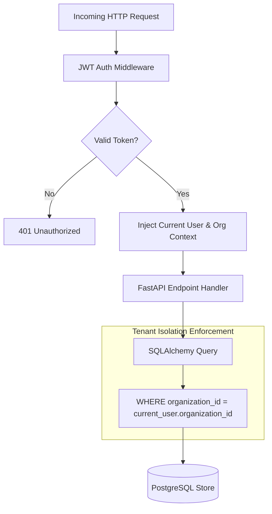

# FlowForge AI — Authentication & Multi-Tenancy

## 1. Multi-Tenancy Architecture

FlowForge AI uses a shared-database, tenant-isolated multi-tenant architecture. Every tenant is represented as an `Organization`.



---

## 2. Row-Level Ownership & Isolation Guarantees

Every persistent entity (`workflows`, `workflow_versions`, `runs`, `audit_events`) contains an `organization_id` foreign key.

### Query Scoping
All database repository queries explicitly scope results by tenant ID:
```python
def get_workflow_for_user(db: Session, workflow_id: UUID, current_user: User) -> Workflow:
    workflow = db.query(Workflow).filter(
        Workflow.id == workflow_id,
        Workflow.organization_id == current_user.organization_id
    ).first()
    
    if not workflow:
        raise HTTPException(
            status_code=status.HTTP_404_NOT_FOUND,
            detail="Workflow not found or access denied"
        )
    return workflow
```

---

## 3. Role-Based Access Control (RBAC)

FlowForge AI defines four distinct organizational roles:

| Role | Scope | Permissions |
|---|---|---|
| **Admin** | Organization-wide | Create, edit, publish workflows; manage users, organizations, integrations, and global settings. |
| **Developer** | Studio | Design, validate, test workflows, view traces and execution logs. |
| **Reviewer / Manager** | Portal | Review and authorize/reject pending approval gates (`human_approval`). |
| **Client / Viewer** | Portal | Browse published service catalog, submit requests, view status timelines. |

### Role Enforcement Dependency
```python
def require_roles(*allowed_roles: str):
    def role_checker(current_user: User = Depends(get_current_user)):
        if current_user.role not in allowed_roles:
            raise HTTPException(
                status_code=status.HTTP_403_FORBIDDEN,
                detail=f"Action requires one of roles: {allowed_roles}"
            )
        return current_user
    return role_checker
```
