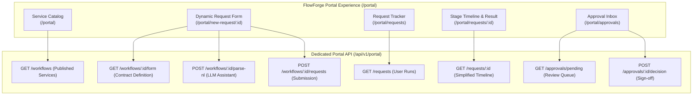

# FlowForge AI — Client Portal Architecture

## 1. Overview & Separation of Concerns

**FlowForge Portal** (`/portal/*`) is the dedicated client and business-user application. It abstracts away all technical workflow complexities (such as DAG topologies, edge handles, JSON schemas, and Python execution environments) into a clean, modern, self-service SaaS portal.

---

## 2. Portal Screens & User Journey

### 2.1 Service Catalog (`/portal`)
- Displays all published workflows available within the organization.
- Highlights workflow name, description, category tag, and average processing turnaround.
- Direct "Launch Service" call-to-action button leading directly to the request submission page.

### 2.2 New Request Form (`/portal/new-request/:id`)
- **Dual-Mode Submission**:
  - **Dynamic Form View**: Automatically builds input controls based on the workflow's `input_contract` (`text`, `number`, `boolean`, `select`, `multiline`, `email`).
  - **AI Natural Language Assistant**: Allows users to paste an email or write a freeform prompt. Clicking *"Extract with AI"* calls the LLM parser to populate the form fields and prompts for any missing requirements.
- Validates all required fields before dispatching `POST /api/v1/portal/workflows/{id}/requests`.

### 2.3 Request Tracker (`/portal/requests`)
- Searchable and filterable table of past and ongoing requests.
- Shows submission timestamps, service names, high-level status badges (`RUNNING`, `PAUSED`, `SUCCEEDED`, `FAILED`), and quick links to stage timelines.

### 2.4 Request Detail & High-Level Stage Timeline (`/portal/requests/:id`)
- Replaces raw node execution traces with a clean **Business Stage Timeline**:
  - `Initiated`: Request received and validated against input contract.
  - `AI Analysis`: Automated classification, structured extraction, or RAG search.
  - `Review Gate`: Displays current human approval status (if applicable).
  - `Completed`: Final payout or resolution artifact generated.
- Shows the final resolution summary card with formatted output data once the run completes.

### 2.5 Approval Inbox (`/portal/approvals`)
- Displays pending approval gates requiring the user's role (e.g. `finance_manager`).
- Detailed drawer showing the transaction payload, AI extracted values, and risk indicators.
- Instant "Approve" (green) and "Reject" (red) actions with optional reviewer commentary.
