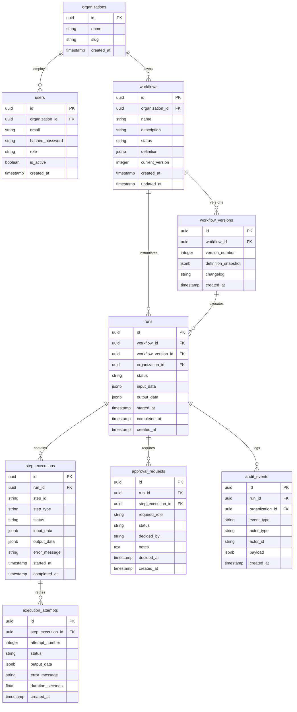

# FlowForge AI — Database Schema & Data Models

## 1. Relational Entity Relationship Diagram (ERD)

All operational and analytical data in FlowForge AI is persisted in PostgreSQL. The relational schema is managed with SQLAlchemy 2.0 ORM and versioned via Alembic migrations.

---

## 2. Table Specifications & Indexing Strategy

### `workflows` & `workflow_versions`
- **Immutability Guarantee**: When a workflow is published, a row is inserted into `workflow_versions` storing a full JSONB snapshot of `definition`. The `workflow_versions` table has a unique index on `(workflow_id, version_number)`. Draft modifications alter `workflows.definition` without affecting existing versions.
- **Indexes**: `ix_workflows_organization_id`, `ix_workflow_versions_workflow_id`.

### `runs`
- **State Enforcement**: Tracks lifecycle status (`PENDING`, `RUNNING`, `PAUSED`, `SUCCEEDED`, `FAILED`, `CANCELED`).
- **Indexes**: `ix_runs_workflow_id`, `ix_runs_organization_id`, `ix_runs_status`.

### `step_executions` & `execution_attempts`
- **Step Level Auditing**: Records input and output payloads for every node in the DAG, enabling deep trace inspection in Studio and execution playback.
- **Retry Auditing**: `execution_attempts` logs duration, error stack traces, and attempt count for resilient exponential backoff monitoring.
- **Indexes**: `ix_step_executions_run_id`, `ix_execution_attempts_step_execution_id`.

### `approval_requests`
- **Governance**: Persists pending review gates, required roles, and resolution commentary (`APPROVED`, `REJECTED`, `EXPIRED`).
- **Indexes**: `ix_approval_requests_run_id`, `ix_approval_requests_status`.
