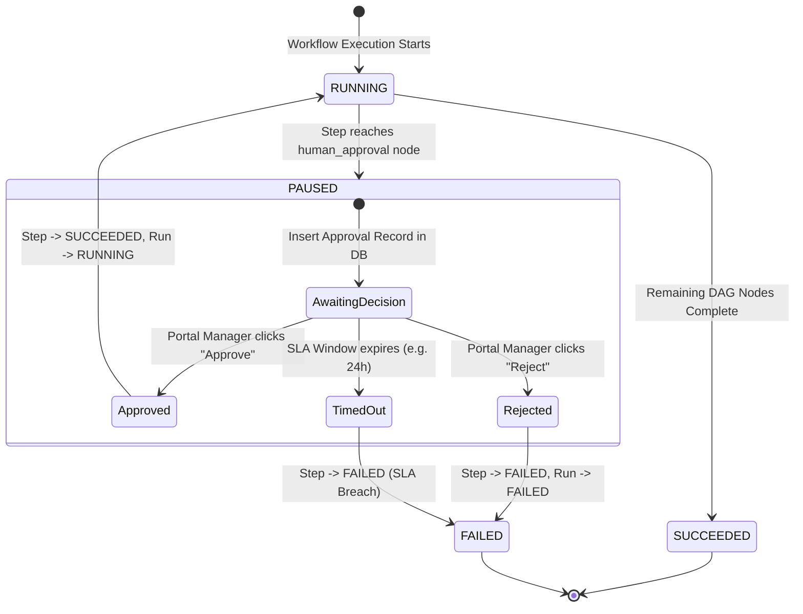

# FlowForge AI — Human-in-the-Loop (HITL) Architecture

## 1. Governance & Financial Safeguards

In autonomous AI systems, high-stakes decisions—such as executing financial disbursements, granting elevated permissions, or issuing legal commitments—cannot be delegated entirely to probabilistic models.

FlowForge AI incorporates **Human-in-the-Loop (HITL)** governance directly into the execution engine. Rather than relying on fragile polling or external webhooks, approval gates are first-class nodes within the DAG state machine.



---

## 2. Pause & Persistence Lifecycle

When the workflow execution engine arrives at a `human_approval` node in topological order:

1. **State Persistence**:
   - The engine updates the step execution status: `StepStatus.RUNNING` -> `StepStatus.PAUSED`.
   - The engine updates the workflow run status: `RunStatus.RUNNING` -> `RunStatus.PAUSED`.
   - Changes are transactionally committed to PostgreSQL.
2. **Approval Record Creation**:
   - An entry is inserted into `approval_requests`:
     ```sql
     INSERT INTO approval_requests (
       id, run_id, step_execution_id, required_role,
       status, summary, payload_snapshot, expires_at
     ) VALUES (
       gen_random_uuid(), :run_id, :step_id, 'finance_manager',
       'PENDING', 'Refund of $250.00 requires finance sign-off', :snapshot, :expiry
     );
     ```
3. **Execution Halting**:
   - The Celery worker task cleanly exits without throwing an error or hanging in a busy-wait loop. No compute or thread pool resources are consumed while waiting for the human.

---

## 3. Resumption Flow via Client Portal

When an authorized reviewer accesses the **FlowForge Portal** (`/portal/approvals`):

1. **Review**: The reviewer inspects pending approval requests, viewing the business summary, execution context, and parsed AI outputs.
2. **Decision Submission**: The reviewer clicks "Approve" or "Reject", optionally attaching review notes. The Portal dispatches:
   ```http
   POST /api/v1/portal/approvals/{approval_id}/decision
   Content-Type: application/json

   {
     "decision": "approved",
     "notes": "Verified transaction ID TX-9982. Approved for immediate disbursement."
   }
   ```
3. **State Machine Resumption**:
   - The endpoint verifies the user's role against `required_role`.
   - The approval record status transitions to `APPROVED`.
   - The paused step status transitions: `StepStatus.PAUSED` -> `StepStatus.SUCCEEDED`, storing the reviewer's identity and notes in `step_execution.output_data`.
   - The run status transitions: `RunStatus.PAUSED` -> `RunStatus.RUNNING`.
   - The endpoint enqueues a new background Celery task `resume_workflow_run_task(run_id)`.
4. **Execution Completion**: The Celery worker resumes the DAG from the next unexecuted node in topological order, successfully completing downstream actions (such as generating the audit receipt and sending confirmation notifications).
