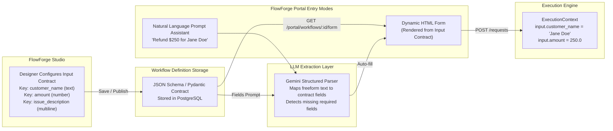

# FlowForge AI — Input Schema & Visual Data Mapping

## 1. Input Architecture Overview

Workflows in FlowForge AI are contract-first. Instead of accepting opaque, arbitrary JSON blobs, workflow designers configure an **Input Contract** (`input_contract`) that declares:
1. Field name and key identifier.
2. Label presented to human users.
3. Field data type (`text`, `number`, `boolean`, `select`, `multiline`, `email`).
4. Whether the field is mandatory (`required`).
5. Default values and placeholder guidance.



---

## 2. InputFieldDefinition Schema

Defined in `backend/app/schemas/workflow.py`:

```python
class InputFieldType(str, Enum):
    TEXT = "text"
    NUMBER = "number"
    BOOLEAN = "boolean"
    SELECT = "select"
    MULTILINE = "multiline"
    EMAIL = "email"

class InputFieldDefinition(BaseModel):
    key: str = Field(..., description="Machine-readable parameter key, e.g. customer_name")
    label: str = Field(..., description="Human-friendly label displayed in portal form")
    type: InputFieldType = Field(default=InputFieldType.TEXT)
    required: bool = Field(default=True)
    default_value: Any | None = None
    options: list[str] | None = None  # For select fields
    placeholder: str | None = None
```

---

## 3. Natural Language Input Parsing & Clarification

When a business user enters freeform text (e.g., *"Customer Jane Doe experienced a double charge of $250.00 for order ORD-991"*), the client portal calls `POST /api/v1/portal/workflows/{id}/parse-nl`.

### Structured Extraction Prompt
The endpoint constructs a prompt embedding the workflow's input contract:
```text
Extract field values from the user's natural language request into a valid JSON object matching the workflow schema:
Input Contract:
- customer_name (type: text, required: true)
- customer_email (type: email, required: true)
- amount (type: number, required: true)
- issue_description (type: multiline, required: true)
- order_id (type: text, required: false)

User Request: "Customer Jane Doe experienced a double charge of $250.00 for order ORD-991"
```

### Clarification Detection
The LLM response is validated against the required contract fields:
1. If `customer_email` is required but omitted from the prompt, `missing_required_fields` contains `["customer_email"]`.
2. The endpoint returns `needs_clarification: true` with a generated `clarification_prompt`:
   > *"We extracted the customer name, amount, and order ID, but still need the customer's email address to complete submission."*
3. The Portal highlights the missing input field for one-click completion by the user.

---

## 4. Visual Data Mapping & Field Pickers

In FlowForge Studio, developers connect data between nodes without typing error-prone string paths:
1. **Upstream Topological Discovery**: When a node is selected, `Builder.jsx` computes all upstream ancestor nodes by walking backward along incoming edges.
2. **Schema Introspection**: It collects all available keys from:
   - Initial `input_contract` (`input.<field>`)
   - Upstream node output contracts (`steps.<node_id>.<field>`)
3. **Visual Chip Selector**: In `NodeInspector.jsx`, developers click from an interactive list of available upstream fields to instantly bind them into mapping rules or condition expressions.
