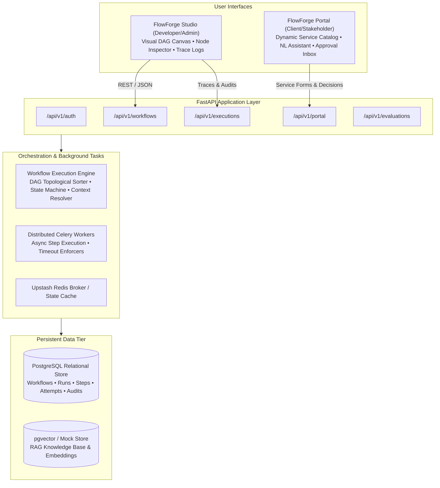

# FlowForge AI — Project Overview

## 1. Executive Summary

**FlowForge AI** is an enterprise-grade visual workflow orchestration platform engineered to design, execute, monitor, and evaluate reliable AI-powered business workflows. Combining the flexibility of modern Large Language Models (LLMs) with the strict determinism, auditability, and guardrails required by enterprise operations, FlowForge bridges the gap between AI experimentation and mission-critical production systems.

The platform provides two distinct, tailored user interfaces sharing a unified execution engine, database, and authentication plane:

1. **FlowForge Studio (Developer & Admin Interface)**: A visual graph designer built on React Flow, enabling engineers to construct complex DAG workflows with deterministic nodes, AI reasoning, conditional branching, RAG knowledge retrieval, and human-in-the-loop gates.
2. **FlowForge Portal (Client & Business User Interface)**: A streamlined, self-service web application where business users and stakeholders submit requests through dynamic forms or natural-language prompts, track multi-stage progress, and review pending human approval decisions.

---

## 2. Core Value Proposition

Enterprise adoption of AI workflows frequently fails due to three systemic shortcomings:
1. **Unconstrained Output Drift**: Raw LLM completions without deterministic type contracts produce silent schema regressions in downstream databases or integrations.
2. **The "Black Box" Problem**: Lack of step-level observability prevents operations teams from debugging execution failures or auditing regulatory compliance.
3. **Overcomplicated Business Interfaces**: Forcing non-technical stakeholders to write JSON payloads or understand graph topologies creates operational friction and human error.

FlowForge AI solves these challenges through:
- **Contract-Driven Input Architecture**: Workflows declare formal input fields (types, requirements, default placeholders) that automatically generate client-facing forms and guide LLM natural-language extraction.
- **Strict Pydantic Output Validation & Repair**: Every AI completion is validated against a machine-readable schema. If validation fails, an automatic repair retry attempts to correct the response without failing the pipeline.
- **Guaranteed State Machine Consistency**: Every workflow run and step transitions through an explicit, verified state machine persisted in PostgreSQL.
- **Enterprise Human-in-the-Loop (HITL)**: Workflow executions can automatically pause at designated approval gates, notify stakeholders via the Portal, and resume seamlessly upon approval or rejection.

---

## 3. Technology Stack Summary

| Layer | Technologies | Key Responsibilities |
|---|---|---|
| **Backend Framework** | Python 3.12+, FastAPI, Uvicorn | High-throughput asynchronous REST API, OpenAPI schema generation, dependency injection. |
| **Data Persistence** | PostgreSQL 16+, SQLAlchemy 2.0 (ORM), Alembic | Relational storage for workflows, versions, run states, step outputs, attempts, and audit logs. |
| **Task Queue & Broker** | Celery 5.x, Redis (Upstash TLS) | Asynchronous task distribution, background execution, retry policies, and worker decoupling. |
| **AI Runtime** | Google Gemini SDK, LiteLLM, Pydantic v2 | Model abstraction, structured JSON extraction, schema repair, semantic classification, and RAG retrieval. |
| **Frontend Framework** | React 18, Vite 6, Plain JavaScript (JSDoc) | Single-Page Application (SPA) hosting both FlowForge Studio and FlowForge Portal without TypeScript overhead. |
| **Visual Graph Canvas** | `@xyflow/react` (React Flow 12), Lucide React | Interactive DAG layout, drag-and-drop node configuration, dynamic TRUE/FALSE condition handles. |
| **Testing & Quality** | Pytest, Pytest-Asyncio, Vitest, Ruff | Comprehensive unit, integration, failure injection, and frontend component test suites. |
