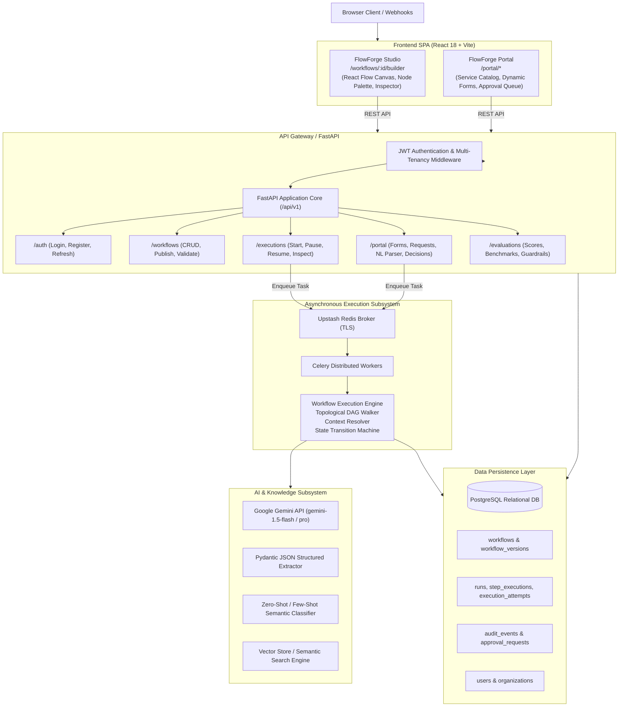

# FlowForge AI — System Architecture

## 1. Architectural Blueprint

FlowForge AI employs a modular monolithic backend paired with an asynchronous distributed execution tier and a unified single-page frontend. This architecture ensures operational simplicity while providing horizontal scalability for computation-intensive AI and background tasks.

---

## 2. Key Subsystems & Communication Flow

### 2.1 Developer Studio Flow (Design & Publish)
1. **Design**: In FlowForge Studio, a developer constructs a workflow graph, adds nodes, configures parameters, and defines the `input_contract`.
2. **Validation**: The frontend sends the graph definition to `POST /api/v1/workflows/validate`. The backend validates the graph against 11 formal topological and semantic rules (acyclic check, single trigger, valid field paths, reachable nodes).
3. **Publication**: Upon publishing (`POST /api/v1/workflows/{id}/publish`), a new immutable record is written to `workflow_versions` with an incremented version number. All future executions of that version reference this immutable snapshot.

### 2.2 Client Portal Flow (Request Submission & Execution)
1. **Dynamic Form Fetch**: When a user accesses `/portal/new-request/{id}`, the Portal requests `GET /api/v1/portal/workflows/{id}/form`.
2. **Natural Language Parsing**: If the user provides a freeform natural-language prompt, `POST /api/v1/portal/workflows/{id}/parse-nl` invokes an LLM to populate the defined contract fields and flags any missing required fields.
3. **Run Enqueueing**: Upon submission, `POST /api/v1/portal/workflows/{id}/requests` validates the payload against the contract, inserts a new `runs` row in `PENDING` status, and dispatches an asynchronous task to Celery via Redis.
4. **Execution & Resumption**: Celery worker runs `execute_workflow_run_task`, executing nodes in topological order. If a `human_approval` gate is encountered, the run is paused, and an approval record is created. Once approved via the Portal, the step transitions to `SUCCEEDED`, and the remaining DAG resumes.

---

## 3. High-Availability & Scalability Characteristics

- **Stateless API Tier**: FastAPI instances maintain no in-memory session state. All session authentication uses signed JWT tokens with claims (`user_id`, `org_id`, `role`), enabling effortless horizontal autoscaling behind any L7 load balancer.
- **Decoupled Execution Tier**: Heavy AI inferences, LLM calls, and external HTTP integrations run inside independent Celery worker processes. A spike in client submissions buffers in the Redis queue without starving the API of CPU or thread pool resources.
- **Relational Consistency**: PostgreSQL acts as the single source of truth. Workflow states, attempts, and step logs are committed transactionally, preventing zombie runs or lost execution state during worker crashes.
