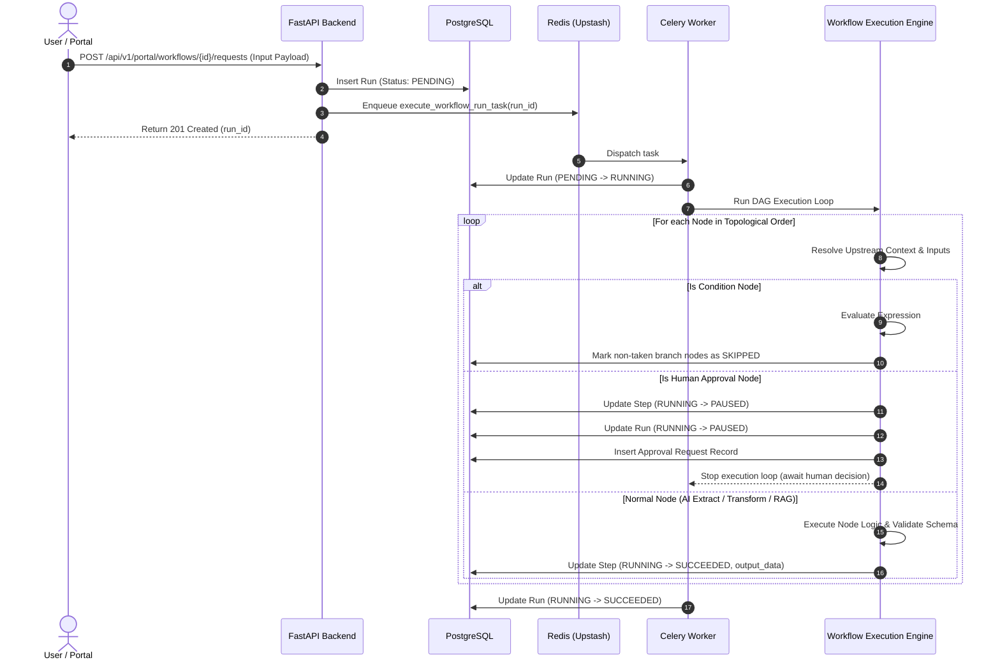

# FlowForge AI — Workflow Execution Engine

## 1. Engine Core Responsibilities

The FlowForge Execution Engine (`backend/app/workflows/engine.py` and `backend/app/workflows/context.py`) is responsible for orchestrating Directed Acyclic Graph (DAG) executions.

Its key responsibilities include:
1. **DAG Graph Validation**: Ensuring the workflow contains no cycles, has a single entry trigger, and contains valid edge references.
2. **Topological Ordering**: Calculating the exact execution sequence of nodes using Kahn's algorithm.
3. **Execution Context Management**: Resolving upstream node outputs and input contracts into a unified runtime context.
4. **Conditional Branch Pruning**: Evaluating condition nodes and marking non-selected branches as `SKIPPED`.
5. **Human Approval Pausing & Resumption**: Pausing workflow runs when hitting approval gates and safely resuming upon stakeholder decisions.
6. **Error Handling & Retries**: Enforcing per-step retry policies with exponential backoff and recording attempt records.



---

## 2. Topological Sorting Algorithm

Topological ordering ensures that no node executes before all of its required upstream dependencies have completed and produced outputs.

```python
def get_execution_order(workflow_def: WorkflowDefinition) -> list[str]:
    in_degree = {node.id: 0 for node in workflow_def.nodes}
    adj_list = {node.id: [] for node in workflow_def.nodes}
    
    for edge in workflow_def.edges:
        adj_list[edge.source].append(edge.target)
        in_degree[edge.target] += 1
        
    queue = [node_id for node_id, deg in in_degree.items() if deg == 0]
    order = []
    
    while queue:
        curr = queue.pop(0)
        order.append(curr)
        for neighbor in adj_list[curr]:
            in_degree[neighbor] -= 1
            if in_degree[neighbor] == 0:
                queue.append(neighbor)
                
    if len(order) != len(workflow_def.nodes):
        raise CycleDetectedError("Graph contains circular dependencies")
    return order
```

---

## 3. Dynamic Context Resolution & Aliasing

Nodes reference execution state using dot-notation paths. The `ExecutionContext` (`backend/app/workflows/context.py`) resolves paths across multiple supported namespace conventions:

| Syntax Pattern | Resolution Target | Example |
|---|---|---|
| `input.<key>` | Initial payload submitted to the workflow | `input.customer_email` |
| `steps.<node_id>.<field>` | Output generated by an upstream step | `steps.node_extract.amount` |
| `upstream_outputs.<node_id>.<field>` | Backward-compatible alias for upstream outputs | `upstream_outputs.node_ai.category` |
| `<key>` | Direct key lookup in initial workflow inputs | `order_id` |

### Path Resolution Logic
```python
def resolve_path(self, path: str) -> Any:
    # 1. Normalize namespace
    clean_path = path.strip("{}").strip()
    parts = clean_path.split(".")
    
    # 2. Check input namespace
    if parts[0] == "input":
        return self._traverse(self.initial_input, parts[1:])
        
    # 3. Check steps / upstream_outputs namespace
    if parts[0] in ("steps", "upstream_outputs"):
        step_id = parts[1]
        step_output = self.step_outputs.get(step_id, {})
        return self._traverse(step_output, parts[2:])
        
    # 4. Fallback: check initial inputs or step outputs
    if parts[0] in self.initial_input:
        return self._traverse(self.initial_input, parts)
    if parts[0] in self.step_outputs:
        return self._traverse(self.step_outputs[parts[0]], parts[1:])
        
    return None
```

---

## 4. Conditional Branch Pruning

When a `condition` node evaluates its expression (e.g., `amount > 100`):
1. The engine checks the condition rules:
   - Operators supported: `greater_than`, `less_than`, `equals`, `not_equals`, `contains`, `in`.
2. The evaluated branch result is determined: `"true"` or `"false"`.
3. The engine inspects all outgoing edges from the condition node:
   - Edges matching `source_handle == result_branch` remain active.
   - Edges with other `source_handle` values are pruned: all downstream nodes exclusively dependent on the inactive branch are immediately marked as `StepStatus.SKIPPED` in PostgreSQL, preventing wasted compute or hanging execution states.
