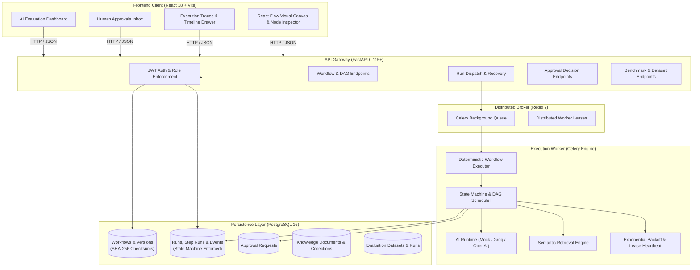

# Architecture Reference — FlowForge AI

FlowForge AI is an enterprise-grade AI workflow orchestration platform engineered with Python (FastAPI, SQLAlchemy 2.x, Celery) and React (Vite, React Flow).

---

## 1. High-Level Architecture



---

## 2. Core Subsystems

### A. API & Security Layer (`app/api/`, `app/core/security.py`)
- **FastAPI 0.115+**: Async request handling, Pydantic v2 serialization, and custom OpenAPI schema generation.
- **Authentication**: PBKDF2-SHA256 password hashing with salt; PyJWT HMAC-SHA256 bearer tokens with configurable expiration.
- **RBAC Enforcement**: Granular role-based security (`admin`, `reviewer`, `operator`) injected as FastAPI route dependencies (`app/api/deps.py`).
- **Idempotency Guard**: Client-supplied `Idempotency-Key` headers evaluated with canonical hashing to prevent double-execution of non-idempotent operations.

### B. Durable State Machine (`app/workflows/state_machine.py`)
- **Explicit Transitions**: Validated state machine for `WorkflowRun` (`PENDING` -> `QUEUED` -> `RUNNING` -> `PAUSED` / `SUCCEEDED` / `FAILED` / `CANCELLED`) and `StepRun` (`PENDING` -> `QUEUED` -> `RUNNING` -> `RETRY_WAIT` -> `SUCCEEDED` / `FAILED` / `PAUSED` / `SKIPPED`).
- **PostgreSQL as Single Source of Truth**: All state transitions, output payloads, and step attempts are written atomically to PostgreSQL before notifying worker threads or HTTP clients.
- **Audit Event Log**: Append-only `execution_events` records state transition timestamps, worker lease IDs, latency in milliseconds, and token consumption for compliance and debugging.

### C. Graph Scheduling & Validation (`app/workflows/`)
- **Topological Traversal**: Uses Kahn's algorithm for acyclic dependency scheduling.
- **Branch Routing & Skip Cascading**: Identifies unselected branches from `condition` nodes and cascades `SKIPPED` statuses down the unchosen DAG path without triggering execution.
- **Tamper-Evident Versioning**: Workflow definitions receive deterministic SHA-256 checksums upon publication. Once published, workflow versions are immutable.

### D. AI Runtime & Validation (`app/ai/`)
- **Provider Abstraction**: Abstract `BaseAIProvider` implemented by `MockAIProvider` (deterministic heuristics and offline testing) and `OpenAICompatibleProvider` (OpenAI, Groq, Ollama).
- **Structured Validation**: Cleans markdown delimiters (` ```json `), validates classification categories against allowed lists, and validates JSON payloads against strict `jsonschema` definitions.
- **Cost & Latency Accounting**: Per-step and per-run tracking of prompt tokens, completion tokens, latency (ms), and calculated cost in USD.

### E. Semantic Knowledge Retrieval (`app/retrieval/`)
- **Scoring Engine**: Term frequency overlap and exact phrase proximity scoring with configurable `score_threshold` and `top_k` clipping.
- **Policy Storage**: Relational document storage linked to versioned collections with extensible metadata tags.

### F. Human-in-the-Loop Governance (`app/models/approval.py`, `app/api/v1/approvals.py`)
- **Execution Pausing**: When a `human_approval` node executes, the step and workflow run transition to `PAUSED`. Celery worker cleanly exits without blocking.
- **Review Inbox**: Dedicated queue of `PENDING` approval requests with diff preview, requested amount, and role requirements.
- **Resumption**: Reviewer decisions (`APPROVED` / `REJECTED`) update the approval record, emit audit events, and resume the Celery execution task.

### G. AI Evaluation Benchmarking (`app/evaluations/`)
- **Evaluation Runner**: Benchmarks workflow versions against standardized golden datasets.
- **Metrics Computation**: Tracks accuracy score, passed/failed test cases, execution latency, and aggregated token cost per model revision.
