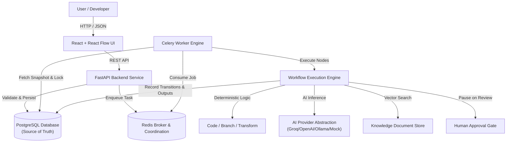

# Architecture Overview — FlowForge AI

FlowForge AI is an enterprise-grade AI workflow orchestration engine built on Python (FastAPI, SQLAlchemy, Celery) and React (Vite, React Flow).

## 1. System Architecture

## 2. Core Subsystems

### A. API Layer (FastAPI)
- Exposes versioned REST endpoints (`/api/v1/...`).
- Validates requests and inputs using Pydantic schemas.
- Handles authentication and per-user authorization checks.
- Returns immediate responses with identifiers for background work.
- Does not contain heavy business logic; delegates to service and engine layers.

### B. Persistence Layer (PostgreSQL & SQLAlchemy 2.x)
- Single authoritative source of truth for:
  - Users and credentials
  - Workflow definitions and immutable versions
  - Workflow runs and step runs
  - Step execution attempts and outputs
  - Append-only execution audit events
  - Human approval requests and decisions
  - Knowledge collections and documents
  - Evaluation datasets and benchmark results
- Enforces relational constraints, unique idempotency keys, and explicit status enums.
- Database migrations managed via Alembic.

### C. Execution Engine (`app/workflows/`)
- **State Machine**: Pure, deterministic state machine validating step states (`PENDING`, `QUEUED`, `RUNNING`, `RETRY_WAIT`, `SUCCEEDED`, `FAILED`, `PAUSED`, `CANCELLED`, `SKIPPED`) and workflow run states.
- **Scheduler**: Identifies ready nodes in the directed acyclic graph based on completed upstream dependencies and conditional branch outcomes.
- **Executor**: Executes registered node implementations, validates outputs against node contracts, records latency and token metrics, and persists output references.
- **Recovery & Leases**: Tracks step execution leases to recover orphaned running steps without executing non-idempotent operations blindly.

### D. AI Provider Abstraction (`app/ai/`)
- Unified interface for multi-provider LLM calls (`generate_structured`, `classify`, `extract`).
- Strict Pydantic validation of model output.
- Normalized error handling (categorizing rate limits, timeouts, and non-retryable errors).
- Built-in token, latency, and estimated cost tracking.
- Zero-dependency Mock Provider for local testing and CI without external API keys.

### E. Frontend (`frontend/`)
- Plain JavaScript with React 18+ and Vite.
- Visual workflow editor powered by React Flow with custom node designs.
- Step-by-step execution inspector with chronological timeline, status badges, and output viewers.
- Human approval inbox with detailed diffs and decision actions.
- Evaluation dashboard with accuracy, F1, latency, and cost visualizations.
