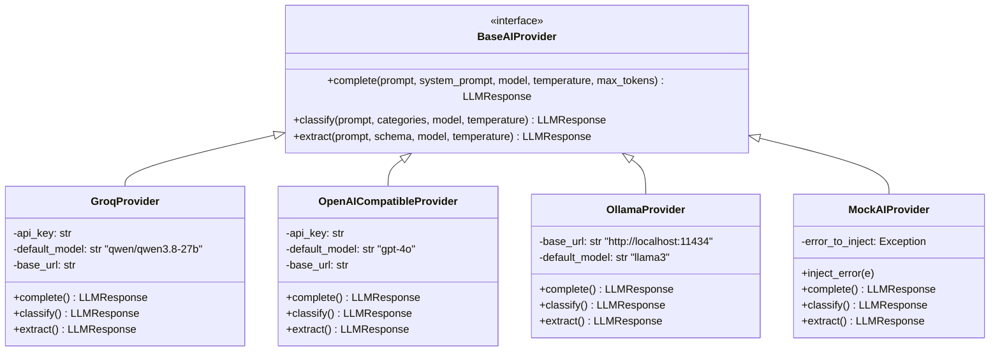

# FlowForge AI — AI Subsystem, Provider Routing & Guardrails

## 1. Provider Adapter Architecture

FlowForge AI abstracts all model inference behind the `BaseAIProvider` interface. This allows seamless switching between ultra-fast cloud LPU inference (Groq), enterprise APIs (OpenAI), self-hosted models (Ollama), and deterministic local mock providers for unit testing.



---

## 2. Guardrails & Structured Output Enforcement

LLM outputs are strictly validated before being accepted into the workflow execution graph:

1. **Deterministic Parameters**: `temperature=0.0` is enforced by default to minimize output variance across executions.
2. **Markdown Stripping & JSON Recovery**: Markdown code block fences (e.g. ` ```json ... ``` `) and trailing commentary are automatically parsed and cleaned.
3. **Pydantic & JSONSchema Validation**: Extracted structures are validated against node schemas. If required fields are missing or types are mismatched, a `ModelOutputInvalidError` is raised.
4. **Error Categorization**:
   - `RATE_LIMIT` (HTTP 429): Classified as retryable transient error. Schedules bounded exponential backoff.
   - `MODEL_OUTPUT_INVALID`: Classified as validation failure. Triggers bounded re-prompting with schema feedback.
   - `PERMANENT_CONFIG`: Fatal error, fails step fast.

---

## 3. Cost & Token Attribution Formula

Every AI invocation calculates real-time USD cost and token usage:
$$\text{Cost} = \left(\frac{\text{Prompt Tokens}}{1{,}000{,}000} \times \text{Prompt Rate}\right) + \left(\frac{\text{Completion Tokens}}{1{,}000{,}000} \times \text{Completion Rate}\right)$$

Costs are accumulated onto the parent `WorkflowRun` and logged in the `execution_events` audit table.
