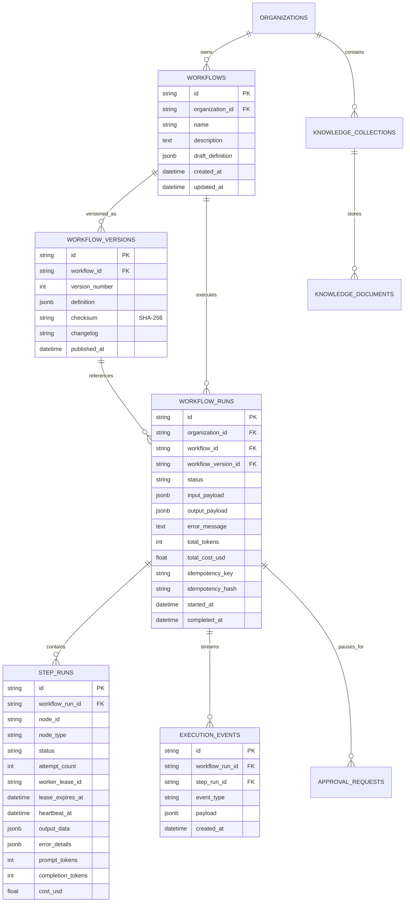

# FlowForge AI — Database Design & Schema Specification

## 1. Relational Entity Schema

FlowForge AI uses PostgreSQL as the single persistent source of truth. All tables use UUID primary keys and timestamped tracking columns.

---

## 2. Key Database Constraints & Performance Indexes

1. **Version Immutability**:
   - `uq_workflow_version_number (workflow_id, version_number)`: Guarantees sequential version numbering per workflow.
   - Published `WorkflowVersion` records are never updated in place; updates require creating a new version.

2. **Step Execution Uniqueness**:
   - `uq_step_run_workflow_node (workflow_run_id, node_id)`: Enforces that exactly one `StepRun` record exists per DAG node within a given workflow run.

3. **Tenant Indexing**:
   - `idx_workflows_organization_id`: Fast tenant scoping for workflow catalogs.
   - `idx_workflow_runs_organization_id`: Instant scoping for runs and monitoring dashboards.

4. **Distributed Lease Queries**:
   - `idx_step_runs_lease_expires_at`: Indexed timestamp enabling rapid $O(\log N)$ recovery scans for expired zombie leases.
