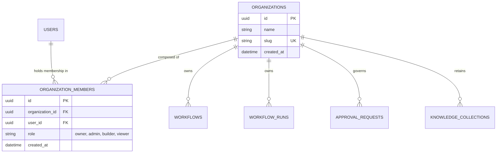

# FlowForge AI — Multi-Tenancy Architecture & Authentication

## 1. Multi-Tenant Organization Model

FlowForge AI implements an enterprise B2B multi-tenant architecture designed to strictly isolate customer data, workflows, execution runs, and team permissions.

---

## 2. Organization Roles & Privileges (RBAC)

| Role | Workflows | Executions | Human Approvals | Team Management | Billing & Org Settings |
|---|---|---|---|---|---|
| **Owner** | Full CRUD + Publish | Trigger + Cancel | Full Review Authority | Add/Remove Members | Full Access |
| **Admin** | Full CRUD + Publish | Trigger + Cancel | Full Review Authority | Add/Remove Members | Read Only |
| **Builder** | Full CRUD + Publish | Trigger + Cancel | Read Only | None | None |
| **Viewer** | Read Only | Read Only | Read Only | None | None |

---

## 3. Server-Side Tenant Resolution (`TenantContext`)

Every API request passes through the `get_tenant_context` dependency:
1. **User Authentication**: Extracted from `Authorization: Bearer <JWT>` header.
2. **Explicit Workspace**: Read from the `X-Organization-ID` HTTP header.
3. **Membership Validation**: Database query verifies that `OrganizationMember` exists linking `user.id` and `organization.id`.
4. **403 Forbidden Rejection**: If the user is not a verified member of the requested organization, the gateway terminates the request immediately.
5. **Default Provisioning**: If `X-Organization-ID` is not supplied, the system defaults to the user's personal organization, created automatically upon registration.
