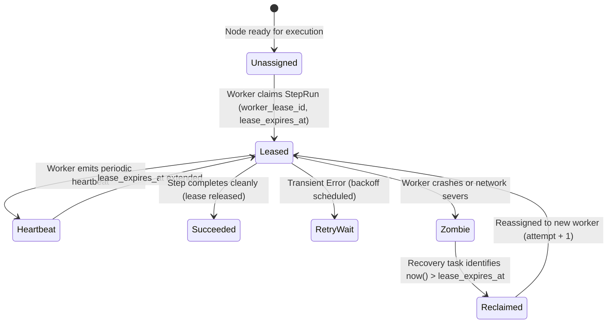

# FlowForge AI — Reliability, Concurrency & Failure Recovery

## 1. Concurrency Controls & Worker Leases

To support horizontal worker clusters without race conditions, FlowForge AI uses distributed optimistic leases:



---

## 2. Bounded Exponential Backoff with Jitter

When upstream AI providers return `HTTP 429 Rate Limit` or network timeouts, the engine calculates backoff using full jitter:

$$\text{Delay} = \min\left(\text{MaxBackoff}, \text{Base} \times \text{Factor}^{(\text{Attempt})} + \text{UniformRandom}(0, \text{Jitter})\right)$$

- **Base Seconds**: `1.0s` (customizable per node)
- **Factor**: `2.0`
- **Max Retries**: Default `3` attempts
- **Max Backoff**: Capped at `60.0s`

---

## 3. Worker Crash & Zombie Execution Recovery

If a worker node experiences a hard termination (OOM kill, power severance, host crash) while executing a workflow:
1. The step remains in `RUNNING` status with an unrenewed `lease_expires_at` timestamp.
2. The recovery task executes query:
   ```sql
   SELECT * FROM step_runs 
   WHERE status = 'RUNNING' 
     AND lease_expires_at < NOW();
   ```
3. Expired steps are transitioned to `RETRY_WAIT` (if attempts < max_retries) or `FAILED`, and the parent workflow run is re-enqueued for clean resumption.
