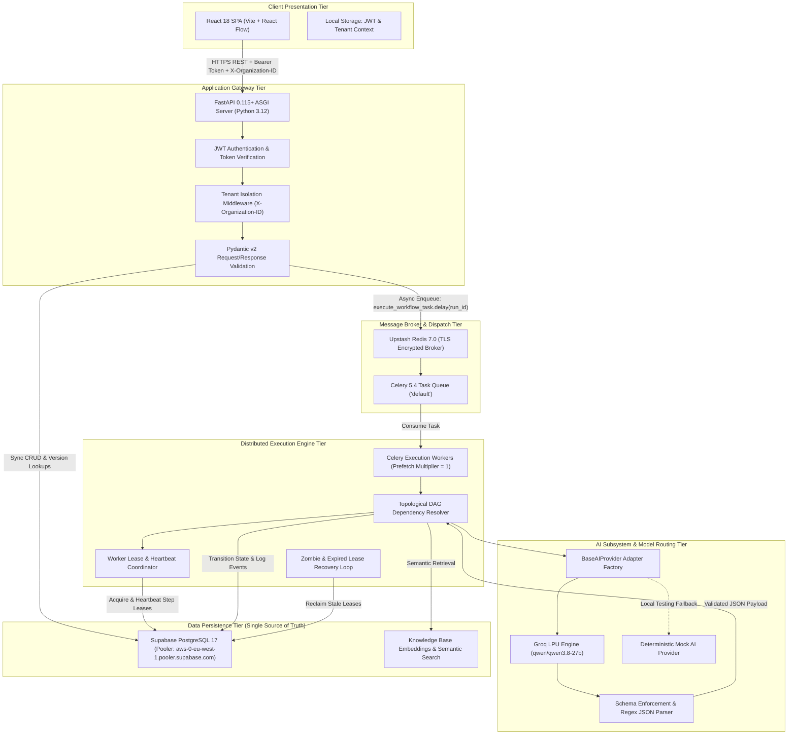

# FlowForge AI — High-Level System Architecture & Component Diagram

## 1. System Topology Diagram

---

## 2. Component Communication Protocols

1. **Client to API Gateway (Synchronous HTTPS)**:
   - JSON payloads over TLS 1.3.
   - `Authorization: Bearer <jwt_token>` header on all protected routes.
   - `X-Organization-ID: <org_uuid>` header specifying the active tenant workspace.
   - Prompt response latency: `<40ms` for run dispatch (returns `202 Accepted` with `run_id`).

2. **API Gateway to Upstash Redis (Asynchronous Broker)**:
   - Encrypted Redis connection (`rediss://`) via TLS on port `6379`.
   - Free-tier rate limiting optimization: broker and result backend routed through `/0`, prefetch locked to `1` to eliminate command waste.

3. **Celery Worker to PostgreSQL (Synchronous Database Transactions)**:
   - SQLAlchemy 2.0 ORM with connection pooling (`pool_recycle=300`, `pool_pre_ping=True`).
   - Transactional state updates for every step transition (`PENDING` -> `RUNNING` -> `SUCCEEDED`).
   - Granular event logging to `execution_events` table for audit observability.

4. **Worker to AI Provider (External Inference HTTPS)**:
   - Groq Cloud API (`https://api.groq.com/openai/v1/chat/completions`) using LPU hardware acceleration.
   - Structured JSON completion with zero temperature.
   - Bounded exponential backoff retries on rate limits (`HTTP 429`).
