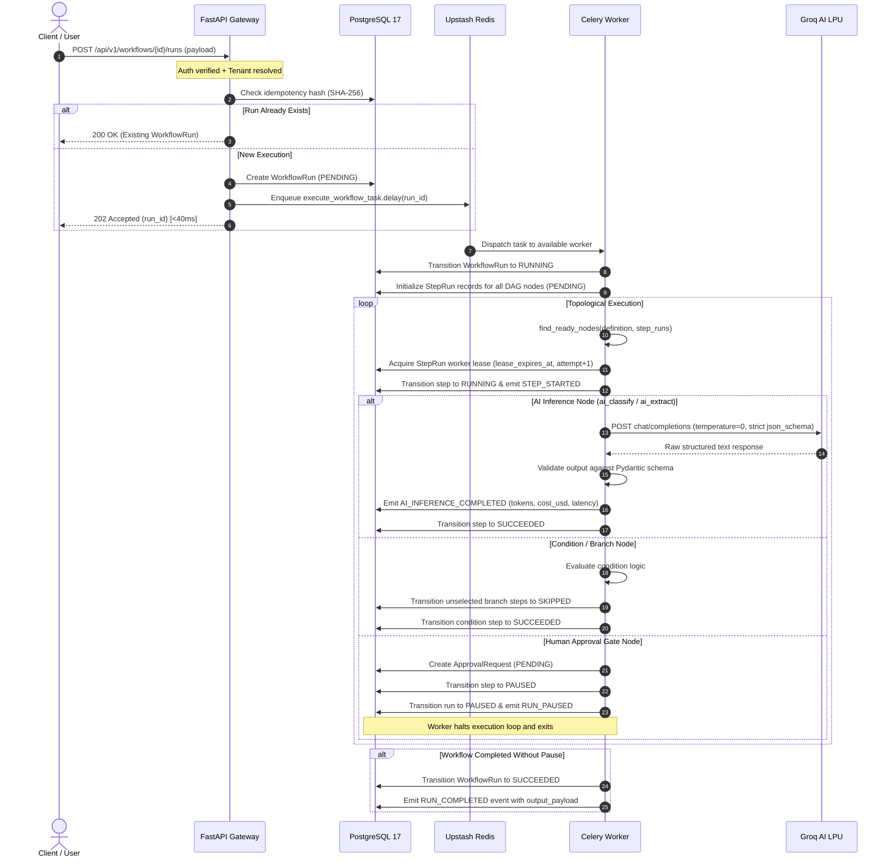

# FlowForge AI — Workflow Execution Lifecycle & State Machine

## 1. Execution Sequence Flow

---

## 2. State Machine Transitions

The execution engine enforces an explicit finite state machine. Invalid transitions (e.g. `SUCCEEDED` -> `RUNNING` or `FAILED` -> `SUCCEEDED`) raise `InvalidStateTransitionError` and are rejected before touching the database.

### Workflow Run Valid Transitions
- `PENDING` -> `QUEUED`, `RUNNING`, `CANCELLED`
- `QUEUED` -> `RUNNING`, `CANCELLED`
- `RUNNING` -> `PAUSED`, `SUCCEEDED`, `FAILED`, `CANCELLED`
- `PAUSED` -> `RUNNING`, `CANCELLED`
- `SUCCEEDED` -> Terminal state
- `FAILED` -> Terminal state
- `CANCELLED` -> Terminal state

### Step Run Valid Transitions
- `PENDING` -> `RUNNING`, `SKIPPED`, `CANCELLED`
- `RUNNING` -> `SUCCEEDED`, `FAILED`, `PAUSED`, `RETRY_WAIT`, `CANCELLED`
- `RETRY_WAIT` -> `RUNNING`, `FAILED`, `CANCELLED`
- `PAUSED` -> `RUNNING`, `CANCELLED`
- `SUCCEEDED` -> Terminal state
- `SKIPPED` -> Terminal state
- `FAILED` -> Terminal state
